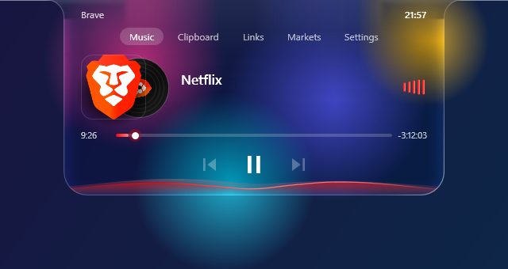
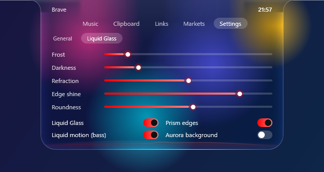
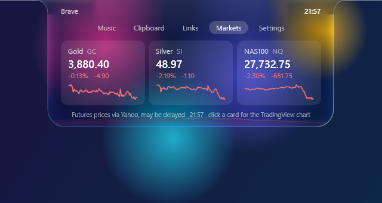
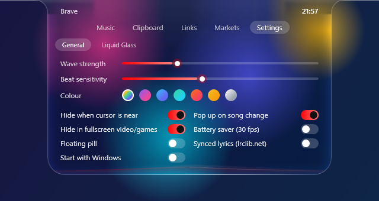

# OpenDynamic: Dynamic Island for Windows

A notch at the top of your Windows screen, inspired by the iPhone Dynamic Island. It shows what's playing with a live audio visualizer. Push the cursor to the top edge to open a card with your clipboard, bookmarks, market prices and settings, all on a see-through Liquid Glass background.



## Features

### Music
- Works with any app that shows up in Windows' media controls (Spotify, YouTube or Netflix in a browser, and others), using Windows' own media API (GSMTC).
- Cover art, title, a seek bar, and play/pause, next and previous. Supports shuffle and repeat. The mouse wheel changes the system volume.
- **Live visualizer:** reads what your speakers are actually playing (WASAPI loopback) and splits it into bass and vocals. The bass drives a big swell on every kick; the vocals drive a second, flowing wave.
- **Track change:** a vinyl disc spins out and the cover flips. The notch can pop up for a moment to show the new song.
- **Synced lyrics:** optional, from lrclib.net.

### The notch
- **Collapsed:** a small black notch that clicks through, so it never blocks your browser tabs. It shows the cover, a beat ring and a progress line. With nothing playing, it shows a clock.
- **Hides itself:** it slides up out of the way when the cursor comes near, and hides during real fullscreen video or games.
- **Opens:** push the cursor to the very top edge of the screen.
- **Shape:** the corners curve out of the screen edge like a real hardware notch. A floating-pill style is also available.

### Liquid Glass
- The open card frosts whatever is behind it.
- The rim bends the background like thick glass and splits light into faint prism fringes.
- The edge ripples with the bass, and a highlight follows your cursor like a light source.
- Frost, darkness, refraction, edge shine and corner roundness are adjustable. An optional aurora background breathes with the music.



### Clipboard
The last 20 things you copied, click to copy again. History is kept in memory only, never on disk. Copies from password managers are skipped.

### Links
One-click tiles for YouTube, Subscriptions, Watch later, Netflix, TradingView, and gold, silver and NAS100 charts. Edit `%AppData%\Island\links.txt`, one link per line:

```
YouTube | https://www.youtube.com
My chart | https://www.tradingview.com/chart/?symbol=OANDA:XAUUSD
```

### Markets
Gold, silver and NAS100 futures prices, with the day's change and a sparkline. Data comes from Yahoo Finance and may be delayed; it refreshes every 60 seconds while the tab is open. Click a card to open the TradingView chart.



### Settings
- Wave strength and beat sensitivity.
- Colour palette: taken from the album art, or a preset.
- Toggles: hide when the cursor is near, pop up on song change, hide in fullscreen, battery saver (30 fps), floating pill, synced lyrics, start with Windows.

Everything applies live and is saved in `HKCU\Software\Island`.



## Install

You need Windows 10 (version 2004 or later) or Windows 11, and the [.NET 9 SDK](https://dotnet.microsoft.com/download/dotnet/9.0).

```bash
git clone https://github.com/autoxhumanlabs-ctrl/opendynamic.git
```

```bash
cd opendynamic
```

```bash
dotnet publish -c Release -r win-x64 --self-contained false -p:PublishReadyToRun=true -o ./publish
```

Run `publish\Island.exe`. Only one copy runs at a time; launching it again pops the card open. Right-click the open card for Settings or Quit.

Self-test: `Island.exe --selftest` (exit code 0 means it passed).

## Performance
- Collapsed notch: about 2–4% of one CPU core.
- Open card with Liquid Glass: about 25% of one core, and only while the card is open.
- The visualizer is capped at 60 fps open and 30 fps collapsed. Battery saver keeps it at 30.

## Built with
.NET 9 WPF, [NAudio](https://github.com/naudio/NAudio) for audio capture, and the Windows media and Win32 APIs.
